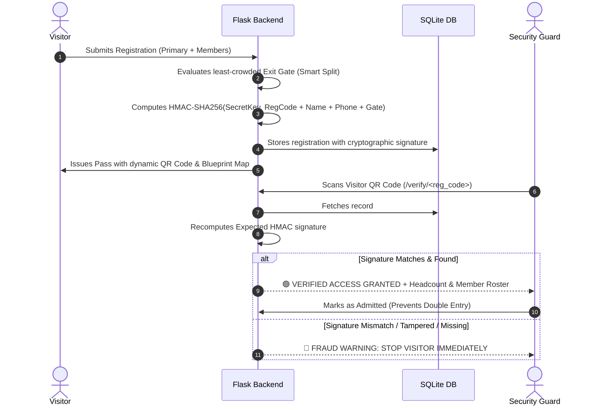

# 🛡️ Smart Venue Entry & Dynamic Crowd Management System

[](https://python.org)
[](https://flask.palletsprojects.com/)
[](https://sqlite.org)
[](LICENSE)
[](https://en.wikipedia.org/wiki/HMAC)
[](.github/workflows/tests.yml)

A production-grade, dynamic **Venue Entry & Smart Crowd Management System** built with **Python (Flask)**, **SQLite**, and **HTML5/CSS3/JavaScript**.

Designed for high-density religious venues (such as temples/mandirs during major festivals) and large-scale public events (concerts, cultural festivals, sports stadiums). Includes an active anti-fraud cryptographic pass engine, capacity-balanced emergency crowd splitting, static entrance QR code posters, and mobile-ready security guard terminals.

---

## 📑 Table of Contents
- [Key Features](#-key-features)
- [Venue Architecture & Flow Layout](#-venue-architecture--flow-layout)
- [Anti-Fraud Security Architecture](#-anti-fraud-security-architecture)
- [Quick Start (Local Setup)](#-quick-start-local-setup)
- [Testing on Mobile (Local Wi-Fi)](#-testing-on-mobile-local-wi-fi)
- [Public Access with ngrok](#-public-access-with-ngrok)
- [Cloud Deployment (Render)](#-cloud-deployment-render)
- [Admin Command & Control Panel](#-admin-command--control-panel)
- [Automated Test Suite](#-automated-test-suite)
- [Project Directory Structure](#-project-directory-structure)
- [Contributing & License](#-license)

---

## 🌟 Key Features

### 1. Neutral Theme & High-Contrast Design
- **Color Palette**: Deep Navy Blue (`#0B192C`, `#1E3E62`), Vibrant Teal (`#00ADB5`), Crisp White, and Slate Gray.
- **Responsive Layout**: Modern card-based UI optimized for mobile touchscreens, tablets, and desktop workstations.

### 2. Static QR Entrance Poster & Mobile Registration
- Venue displays a fixed/static QR code at entry points (`/admin/entrance-poster`).
- Visitors scan with any smartphone camera to open the mobile registration form instantly.
- **Bilingual Multi-Language Engine**: Instant switching between **Hindi (हिंदी)** and **English** for all form labels, buttons, placeholders, and venue guidance.

### 3. Comprehensive Data Collection & Dynamic Sub-Form
- Primary Visitor Name, 10-digit mobile number (validated), Age, and Common Home Address.
- **Dynamic Accompanying Members**: One-click addition of unlimited family/group members (Name, Age, and Optional Mobile) with real-time headcount aggregation.

### 4. Smart Crowd Split & Capacity Load Balancer
- Queries active headcount across all 4 exits in SQLite.
- Dynamically assigns incoming groups to the least congested exit corridor:
  - **Group A &rarr; Exit 1 (West Gate - Zone Alpha)** &bull; Transit Hub
  - **Group B &rarr; Exit 2 (North Gate - Zone Beta)** &bull; Highway Parking
  - **Group C &rarr; Exit 3 (East Gate - Zone Gamma)** &bull; Metro Plaza
  - **Group D &rarr; Exit 4 (South Gate - Zone Delta)** &bull; Taxi Promenade
- **Gate 5 (Hidden Route)**: Dedicated route strictly restricted for staff and emergency response teams.
- **Interactive SVG Venue Blueprint**: Embedded on every pass, dynamically illuminating the exact route from Single Entry to the visitor's assigned exit.

### 5. Cryptographic Anti-Fraud Pass Engine
- Binds Registration Code, Primary Name, Mobile, and Assigned Gate with an HMAC-SHA256 signature using a secret master key.
- Dynamic verification QR code links to `/verify/<registration_code>`.
- One-click print / PDF export formatted via `@media print`.

### 6. Security Guard Verification Terminal (`/verify/<registration_code>`)
- Recalculates cryptographic HMAC in real time.
- **Green "VERIFIED ACCESS GRANTED"**: Displays authorized group headcount, member roster, and assigned exit direction.
- **Live Check-in Toggle**: Allows guards to mark visitors as admitted to prevent ticket reuse.
- **Red "FRAUD WARNING: INVALID ENTRY PASS"**: Alerts guards of counterfeit, altered, or tampered passes.

---

## 🗺️ Venue Architecture & Flow Layout

```
                  [ EXIT 2: NORTH GATE (Zone Beta) ]
                                 ▲
                                 │
     [ EXIT 1: WEST ] ◄── [ CENTRAL ATRIUM ] ──► [ EXIT 3: EAST ]
      (Zone Alpha)         (Assembly Hall)         (Zone Gamma)
                                 ▲
                     ┌───────────┴───────────┐
                     │                       ▼
             [ SINGLE ENTRY GATE ]    [ EXIT 4: SOUTH ]
             (Static QR Scanner)        (Zone Delta)
                     
   ══════════════════════════════════════════════════════════════
   [ GATE 5: HIDDEN ROUTE ] ── Staff & Emergency Evacuation Only
   ══════════════════════════════════════════════════════════════
```

---

## 🔒 Anti-Fraud Security Architecture



---

## 🚀 Quick Start (Local Setup)

### Prerequisites
- Python 3.9 or higher
- Git

### 1. Clone the Repository
```bash
git clone https://github.com/<your-username>/venue-crowd-management.git
cd venue-crowd-management
```

### 2. Create and Activate Virtual Environment
```bash
# Windows (PowerShell)
python -m venv venv
.\venv\Scripts\activate

# Linux / macOS
python3 -m venv venv
source venv/bin/activate
```

### 3. Install Dependencies
```bash
pip install -r requirements.txt
```

### 4. Configure Environment Variables (Optional)
```bash
# Copy template
cp .env.example .env
```

### 5. Launch the Application
```bash
python app.py
```

The system will start on `http://127.0.0.1:5000`:
- **Visitor Portal**: `http://127.0.0.1:5000`
- **Admin Dashboard**: `http://127.0.0.1:5000/admin` *(Default password: `admin123`)*
- **Printable Entrance Poster**: `http://127.0.0.1:5000/admin/entrance-poster`

---

## 📱 Testing on Mobile (Local Wi-Fi)

The server binds to `0.0.0.0:5000`, allowing any device on the same local network to access it:

1. Run `ipconfig` (Windows) or `ifconfig` (Mac/Linux) to find your local IP address (e.g. `192.168.1.25`).
2. On your smartphone's browser, open:
   ```text
   http://192.168.1.25:5000
   ```
3. Test scanning passes between two smartphones (one as visitor pass, one as security guard terminal).

---

## 🌐 Public Access with ngrok

To share a live URL over HTTPS for demonstrations or remote testing:

```bash
# Install ngrok and run
ngrok http 5000
```
Copy the generated `https://<unique-id>.ngrok-free.app` URL and share it with test visitors or venue staff.

---

## ☁️ Cloud Deployment (Render)

Deploy this system for free on **Render**:

1. Push your repository to GitHub.
2. In [Render.com](https://render.com), click **New +** &rarr; **Web Service**.
3. Connect your repository and configure:
   - **Environment**: `Python 3`
   - **Build Command**: `pip install -r requirements.txt`
   - **Start Command**: `gunicorn app:app`
4. Set Environment Variables:
   - `ADMIN_PASSWORD` = `YourCustomPassword`
   - `FLASK_SECRET_KEY` = `StrongRandomSecretKey`
   - `HMAC_SECRET_KEY` = `MasterHMACSecretKey2026`
5. Click **Create Web Service**.

---

## ⚙️ Admin Command & Control Panel

Access `/admin` with password `admin123`:
- **Real-Time Capacity Dashboard**: Live total headcount, passes issued, and admitted visitors.
- **Dynamic Split Analytics**: Percentage progress bars per exit gate.
- **Searchable Registry**: Live filtering across names, phone numbers, registration codes, and exit gates.
- **Export to CSV**: Streams an RFC 4180 CSV file with full member and address details for security reporting.
- **Print Entrance Poster**: High-resolution bilingual signage ready for venue printing.

---

## 🧪 Automated Test Suite

Run the built-in test suite covering end-to-end integration and anti-tamper security:

```bash
python test_app.py
```

Tests include:
- `test_01_index_page`: English & Hindi bilingual form verification.
- `test_02_registration_and_pass_generation`: Accompanying members & dynamic QR generation.
- `test_03_hmac_verification_and_tampering`: Valid HMAC verification and simulation of database tampering detection.
- `test_04_admin_login_and_export`: Admin session authentication and CSV export formatting.

---

## 📁 Project Directory Structure

```text
├── .github/
│   └── workflows/
│       └── tests.yml              # GitHub Actions CI workflow
├── static/
│   └── style.css                  # Modern high-contrast CSS & print styling
├── templates/
│   ├── base.html                  # Master layout with bilingual i18n engine
│   ├── index.html                 # Mobile-first visitor registration form
│   ├── pass.html                  # Security Pass ID badge with SVG blueprint map
│   ├── verify.html                # Security Guard terminal with HMAC check
│   ├── login.html                 # Admin authentication portal
│   ├── admin.html                 # Analytics dashboard & searchable registry
│   └── entrance_poster.html       # Printable static QR entrance poster
├── .env.example                   # Environment configuration template
├── .gitignore                     # Git ignore rules for Python, SQLite & IDEs
├── app.py                         # Flask backend, SQLite models, crypto & QR logic
├── LICENSE                        # MIT License
├── README.md                      # Comprehensive project documentation
├── requirements.txt               # Production dependencies
└── test_app.py                    # Automated test suite
```

---

## 📄 License

This project is licensed under the MIT License - see the [LICENSE](LICENSE) file for details.
