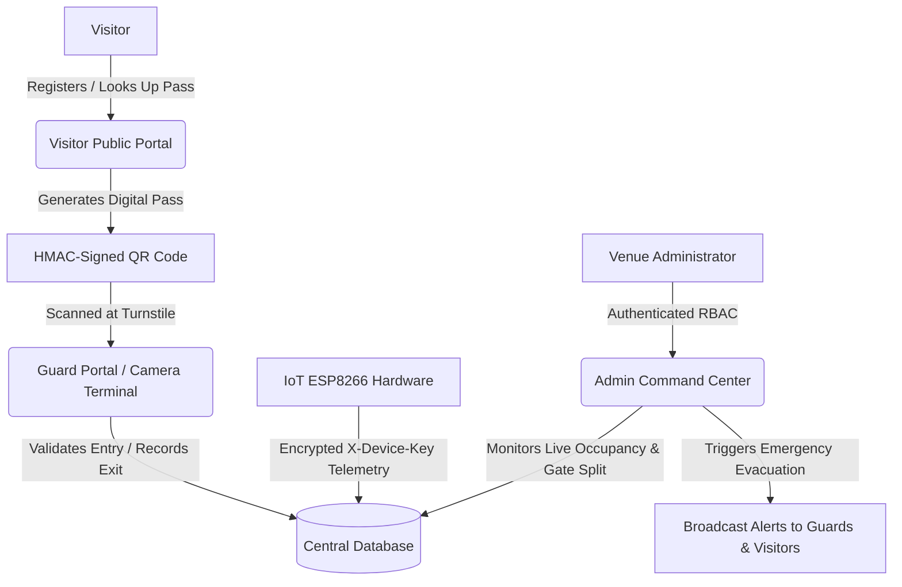

# 🛡️ VenueGuard — Smart Crowd Control Management System

[](https://ritesh926306-rgb.github.io/crowd-management-v2/)
[](https://python.org)
[](https://flask.palletsprojects.com/)
[](https://mysql.com)
[](https://sqlite.org)
[](https://en.wikipedia.org/wiki/HMAC)
[](LICENSE)

VenueGuard is a production-grade, full-stack **Smart Crowd Control & Venue Entry Management System** designed for high-density public venues, religious gatherings, temples, exhibitions, and stadiums. It provides segregated workflows for **Visitors**, **On-Duty Guards**, and **Venue Administrators**, coupled with automated **NodeMCU ESP8266 IoT hardware counters** to prevent bottlenecks, eliminate stampede risks, and block counterfeit passes.

---

## 🌟 Architecture & Three Segregated Portals



### 1. 👥 Visitor Public Portal
- **Streamlined Navigation**: Home, Register, Check My Pass, Venue Information, Help & Safety, and Hindi / English language switch.
- **4-Step Registration Wizard**: Collects Primary Visitor details, supports adding multiple individual family members with ages, review stage, and instant digital pass issuance.
- **Privacy Protection**: Masked mobile numbers and truncated addresses in public-facing templates (`pass.html` and `check_registration.html`).
- **Pass Verification & Download**: High-resolution printable visitor pass with QR code, assigned exit instructions, and single-click PDF / Print.

### 2. 👮 Dedicated Guard Portal (`/guard/login` or `guard_login.html`)
- **Restricted Access**: Role-based PIN / Password authentication with idle timeout protection.
- **Live Camera QR Scanner**: HTML5 real-time camera scanner with instant sound feedback (beep/vibration).
- **Manual Registration Lookup**: Rapid code lookup for damaged screens or non-smartphone visitors.
- **Full Life-Cycle Tracking**: Check-in validation with duplicate pass detection, and checkout recording (`/api/check-out/<reg_code>`) for real-time occupancy updates.
- **Emergency Evacuation Routes**: Immediate emergency alert broadcast with assigned evacuation gates and safety directions.

### 3. 📊 Admin Command Center (`/admin` or `admin.html`)
- **Occupancy Management**: Prototype capacity set to **1000** (fully configurable). Live gauges show Registered Visitors, Current Occupancy Inside, Exited Visitors, and Remaining Capacity.
- **Dynamic Gate Load Balancing**: Tracks distribution across **Main Entry Gate** and public exits (**Exit Gate A, B, C, D**). Restricted staff **Gate E** is excluded from public routes.
- **Audit Logging**: Comprehensive timestamped audit trail of all staff actions, gate admissions, emergency events, and system changes.
- **Multi-Guard Management**: Add, deactivate, and assign guard accounts to specific perimeter gates.
- **Emergency Protocol Activation**: One-click broadcast of emergency evacuation warnings across all terminals.
- **Data Export**: Full CSV export of visitor logs.

---

## 📁 Repository Structure

```
crowd-management-v2/
├── .github/
│   └── workflows/
│       ├── deploy.yml            # CI/CD: Static build deploy to GitHub Pages
│       └── tests.yml             # Automated unit & integration tests
├── .env.example                  # Environment configuration template (safe for VCS)
├── .gitignore                    # Excludes secrets, .env, DB files, venv
├── Dockerfile                    # Containerization manifest
├── package.json                  # Node.js runner scripts
├── README.md                     # Comprehensive project documentation
│
├── backend/                      # 🐍 Flask Backend Server
│   ├── app.py                    # Core backend, REST APIs, HMAC crypto, SQLite/MySQL DB
│   ├── schema.sql                # Production MySQL schema with audit logs & emergency tables
│   ├── requirements.txt          # Python dependencies
│   ├── test_app.py               # Automated integration & security test suite
│   └── venue_crowd.db            # SQLite database (auto-initialized fallback)
│
├── frontend/                     # 🎨 Frontend Web Application
│   ├── build_static.py           # Static site compiler for GitHub Pages deployment
│   ├── templates/                # Jinja2 HTML templates
│   │   ├── base.html             # Base layout, navbar, footer, emergency banner, i18n
│   │   ├── index.html            # Visitor landing page & 4-step registration wizard
│   │   ├── pass.html             # Digital entry pass with QR & printable layout
│   │   ├── check_registration.html # Self-service registration & pass lookup
│   │   ├── venue_info.html       # Venue blueprint, parking, transit & entry rules
│   │   ├── help_contact.html     # Visitor safety guidelines, first aid & emergency numbers
│   │   ├── verify.html           # Guard terminal (camera scanner, check-in, check-out)
│   │   ├── guard_login.html      # Guard authentication screen
│   │   ├── login.html            # Admin login screen
│   │   ├── admin.html            # Real-time analytics, occupancy KPIs, audit log & guards
│   │   └── entrance_poster.html  # High-res printable QR poster for gates
│   └── static/
│       ├── style.css             # Glassmorphism dark-navy responsive design system
│       ├── static-mode.js        # Client-side state bridge for zero-backend GitHub Pages
│       └── html5-qrcode.min.js   # Fast camera QR scanner library
│
├── hardware/                     # ⚡ IoT Hardware & Embedded Firmware
│   ├── esp8266_crowd_monitor.ino # NodeMCU ESP8266 ultrasonic turnstile counter
│   └── README.md                 # Complete pinout, schematic & telemetry spec
│
└── dist/                         # 🌐 Compiled static distribution for GitHub Pages
```

---

## 🔒 Security Hardening

1. **Zero Hardcoded Production Credentials**:
   - All passwords and secret keys are loaded from environment variables (`.env`).
   - Default credentials have been purged from documentation, HTML badges, and JavaScript files.
2. **Cryptographic Anti-Tamper Verification**:
   - Passes are signed using HMAC-SHA256:
     $$\text{HMAC-SHA256}(\text{RegCode} \parallel \text{Name} \parallel \text{Mobile} \parallel \text{Gate}, \text{SecretKey})$$
   - Client passes forged offline or altered in transit are rejected by the server verification engine.
3. **Hardware Telemetry Protection**:
   - Turnstile counters must supply a valid `X-Device-Key` header matching `HARDWARE_DEVICE_KEY` to submit telemetry.
4. **Parameterized SQL Queries**:
   - All database calls use strictly parameterized queries to prevent SQL injection across SQLite, PostgreSQL, and MySQL.
5. **Privacy Safeguards**:
   - Mobile numbers and full home addresses are masked on public views to safeguard visitor PII.

---

## 🚀 Quick Start Guide

### 1. Python Flask Backend Mode

```bash
# 1. Clone repository
git clone https://github.com/ritesh926306-rgb/crowd-management-v2.git
cd crowd-management-v2

# 2. Create and activate virtual environment
python -m venv .venv
# Windows:
.venv\Scripts\activate
# Linux/macOS:
source .venv/bin/activate

# 3. Install dependencies
pip install -r backend/requirements.txt

# 4. Configure environment variables
cp .env.example .env
# Edit .env to set your secure secrets and passwords

# 5. Run automated test suite
python -m unittest discover -s backend -p "test_*.py"

# 6. Start server
python backend/app.py
```
Access the application at `http://localhost:5000`.

### 2. Static GitHub Pages Build Mode

To rebuild static HTML files for zero-backend deployment:
```bash
python frontend/build_static.py
```
This generates the full standalone client-side application in `dist/`.

---

## 🧪 Automated Testing

VenueGuard includes a comprehensive automated test suite covering:
- Visitor registration with individual group members
- Check-registration self-service lookup and verification
- Masked digital pass rendering
- Guard check-in validation and duplicate prevention
- Guard check-out / exit recording and live occupancy calculation
- Admin occupancy metrics and emergency broadcast toggling
- IoT hardware telemetry authentication with `X-Device-Key`

Run tests anytime with:
```bash
python -m unittest discover -s backend -p "test_*.py"
```

---

## 📜 License
This project is open-source software licensed under the [MIT License](LICENSE).
